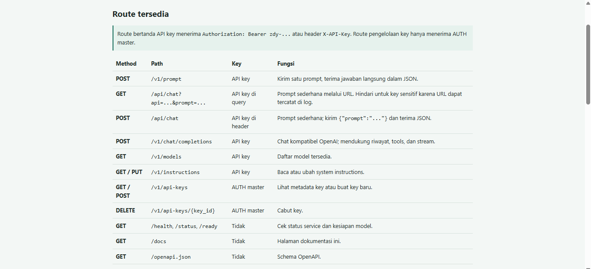

# Zydra

<p align="center">
  <a href="https://github.com/fareldev-hub/ZydraModel">
    
  </a>
  <a href="https://www.docker.com/">
    
  </a>
  <a href="https://ollama.com/library/phi">
    
  </a>
</p>

<p align="center">
  <a href="https://img.shields.io/github/commit-activity/t/fareldev-hub/ZydraModel">
    
  </a>
  <a href="https://github.com/fareldev-hub/ZydraModel/graphs/contributors">
    
  </a>
  <a href="https://img.shields.io/badge/model%20size-~1.6%20GB-blue?style=flat-square">
    
  </a>
  <a href="https://github.com/fareldev-hub/ZydraModel/blob/main/LICENSE">
    
  </a>
</p>

Zydra adalah API chat teks yang menjalankan Ollama dan model `phi` dalam
satu container Docker. Setup pertama kali mengunduh model, membuat model `zydra`,
lalu menjalankan API dan dokumentasi interaktif.

## Statistik dan kontribusi

<p>
  <a href="https://github.com/fareldev-hub/ZydraModel/graphs/contributors">
    
  </a>
</p>

Grafik khusus repository Zydra:

<p>
  <a href="https://github.com/fareldev-hub/ZydraModel/graphs/commit-activity">
    
  </a>
  <a href="https://github.com/fareldev-hub/ZydraModel/graphs/contributors">
    
  </a>
</p>

## Persiapan

Pastikan Docker Engine tersedia. Buat file environment lokal:

```sh
cp .env.example .env
```

Edit `.env` dan ganti `AUTH` dengan password pilihan yang kuat. Jangan commit
`.env`; file tersebut sudah diabaikan Git. `OLLAMA_URL` harus tetap
`http://localhost:11434` karena Ollama berjalan di container yang sama.

Contoh `.env`:

```dotenv
AUTH=ganti-dengan-password-kuat
OLLAMA_URL=http://localhost:11434
API_KEYS_FILE=/data/database/api.json
```

Jika `.env` sudah ada, edit file itu dan jangan menyalin contoh di atas.

## Build dan jalankan

Build image:

```sh
docker build -t zydra-text .
```

Buat volume permanen untuk model dan konfigurasi, lalu jalankan container:

```sh
docker volume create zydra-data
docker run -d \
  --name zydra \
  --restart unless-stopped \
  -p 8000:8000 \
  --env-file .env \
  -v zydra-data:/data \
  zydra-text
```

Pantau setup pertama kali:

```sh
docker logs -f zydra
```

Setup selesai saat log menampilkan `Setup selesai`. Proses ini mengunduh
`phi` lalu membuat model `zydra`. Unduhan model sekitar 1,6 GB; sediakan
ruang disk tambahan untuk Ollama dan data aplikasi. Hentikan tampilan log dengan
`Ctrl+C`; container tetap berjalan.

Pastikan API dan model siap:

```sh
curl http://localhost:8000/health
```

Lanjutkan setelah respons berisi `"model_ready":true`. Buka
<http://localhost:8000/docs> untuk menguji GET/POST dan mengelola API key dengan
password master `AUTH` dari `.env`.



## Uji balasan teks

Gunakan route sederhana `POST /v1/prompt` untuk mengirim satu prompt dan menerima
field `response` langsung:

```sh
set -a
. ./.env
set +a

curl http://localhost:8000/v1/prompt \
  -H "Authorization: Bearer $AUTH" \
  -H "Content-Type: application/json" \
  -d '{"prompt":"Jelaskan fotosintesis secara singkat."}'
```

Alias route ringkas juga tersedia dalam dua method:

```sh
# GET sesuai format query yang diminta
curl --get "http://localhost:8000/api/chat" \
  --data-urlencode "api=$API_KEY" \
  --data-urlencode "prompt=Jelaskan fotosintesis singkat."

# POST; gunakan ini untuk key sensitif karena key dikirim di header
curl "http://localhost:8000/api/chat" \
  -X POST \
  -H "Authorization: Bearer $API_KEY" \
  -H "Content-Type: application/json" \
  -d '{"prompt":"Jelaskan fotosintesis singkat."}'
```

GET menerima `api` dan `prompt` sebagai query parameter, tetapi URL dapat masuk
ke history browser, proxy, dan access log. POST melalui header lebih disarankan.
Keduanya mengembalikan JSON berisi `model`, `response`, dan `creator`.

API chat kompatibel dengan format OpenAI. Uji dari terminal:

```sh
set -a
. ./.env
set +a
curl http://localhost:8000/v1/chat/completions \
  -H "Authorization: Bearer $AUTH" \
  -H "Content-Type: application/json" \
  -d '{"model":"zydra","messages":[{"role":"user","content":"Balas singkat: AI siap"}]}'
```

Jawaban model muncul di `choices[0].message.content`. Endpoint `/health` dan
`/status` tidak memerlukan password. Endpoint API lain memerlukan `AUTH` melalui
header Bearer atau `X-API-Key`.

## Mengelola API keys

Buka <http://localhost:8000/docs> dan masuk dengan password master `AUTH`. Isi
nama key dan pilih **Buat API key**. Key baru berformat `zdy-...`;
salin saat pertama kali muncul karena nilai penuh tidak ditampilkan lagi.

Key terkelola dapat digunakan untuk endpoint API selain route pengelolaan key.
Route `GET /v1/api-keys`, `POST /v1/api-keys`, dan
`DELETE /v1/api-keys/{key_id}` hanya menerima password master `AUTH`. UI
menampilkan prefix dan nama key; key dapat dicabut kapan saja.

Hash SHA-256 dan metadata key disimpan di `database/api.json`. File lokal ini
diabaikan Git. Di Docker, `API_KEYS_FILE=/data/database/api.json` menempatkannya
di volume `zydra-data` sehingga tetap ada saat container dibuat ulang. Key asli
tidak disimpan dalam file.

Semua respons JSON API menyertakan properti `creator` bernilai
`farel alfareza`.

## Lisensi

Base model Microsoft Phi-2 (`phi`) memakai MIT, bukan Apache 2.0; ukuran unduh
varian Ollama yang digunakan sekitar 1,6 GB. Salinan lisensi model dan notice
tersedia di `MODEL_LICENSES/` dan disertakan dalam Docker image di
`/root/MODEL_LICENSES`. Lisensi model berlaku terpisah dari kode proyek.

## Perintah Docker

```sh
docker logs -f zydra
docker stop zydra
docker start zydra
docker rm -f zydra
```

Menghapus container tidak menghapus model selama volume `zydra-data` tetap ada.
Untuk menghapus seluruh data model secara permanen, hapus volume tersebut dengan
`docker volume rm zydra-data`.

Dokumentasi route dan contoh integrasi, generator API key, serta uji prompt
tersedia di <http://localhost:8000/docs>. Root service `/` juga mengarah langsung
ke halaman dokumentasi tersebut.

Notice base model tersedia di `MODEL_LICENSES/`.

---

<div align="center">
  <h2>Tentang Pembuat</h2>
  <a href="https://github.com/fareldev-hub">
    
  </a>
  <h3>Farel Alfareza</h3>
  <p>Pembuat dan pemelihara <strong>Zydra</strong>.</p>
  <a href="https://github.com/fareldev-hub">
    
  </a>
  &nbsp;
  <a href="https://tiktok.com/@logic__vibes">
    
  </a>
  <p>Jika project ini bermanfaat, dukung pengembangannya melalui:</p>
  <a href="https://trakteer.id/farel_alfarez">
    
  </a>
  &nbsp;
  <a href="https://saweria.co/fareldev">
    
  </a>
  <br><br>
  <sub>Terima kasih atas dukungan dan kontribusinya untuk Zydra 💜</sub>
</div>
